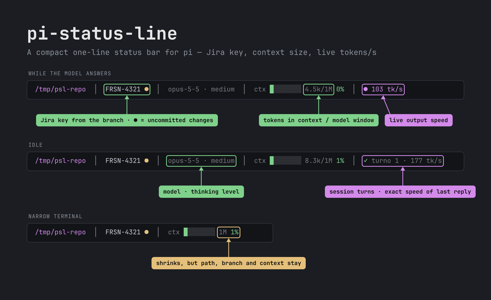

# pi-status-line

Status line compacta, em uma linha, para o [Pi Coding Agent](https://pi.dev). Substitui o footer padrão.



<details><summary>Versão texto</summary>

```
 ~/projetos/vetor-api  │  FRSN-1234 ●  │  opus-5-5 · high  │  ctx ████░░░░ 480k/1M 48%  │  ✓ turno 7 · 62 tk/s
```

</details>

## Instalação

```bash
pi install npm:@igor-guari/pi-status-line
# ou
pi install git:github.com/IgorGuariroba/pi-status-line@v0.2.1
```

Para testar sem instalar: `pi -e npm:@igor-guari/pi-status-line`.

## O que aparece

| Bloco | Detalhe |
|---|---|
| **Pasta** | `~/...` quando cabe; senão só os 2 últimos segmentos |
| **Branch** | Mostra a chave Jira extraída do nome (`feature/frsn-1234-x` → `FRSN-1234`); sem chave, mostra a branch. `●` amarelo = working tree com alterações |
| **Modelo · thinking** | Modelo ativo, abreviado (`claude-opus-5-5` → `opus-5-5`, sem prefixo `vendor/`) e nível de raciocínio (omitido se o modelo não raciocina ou está `off`) |
| **Contexto** | Barra de 8 blocos (`█░`), com ao menos 1 bloco quando há uso, + tokens no contexto / janela do modelo (`480k/1M`, `5k/262k`). Verde < 60%, amarelo < 85%, vermelho acima. Logo após compactar: `ctx ░░░░░░░░ ?/1M` |
| **Custo** | Custo acumulado da sessão; some quando arredonda para zero (ex.: assinatura) |
| **Turno e velocidade** | Rodando: `● 62 tk/s` ao vivo (ou `● rodando` antes do primeiro token). Ocioso: `✓ turno 7 · 62 tk/s` — turnos = prompts da sessão inteira (sobrevive a `/reload` e retomada); velocidade exata da última resposta (tokens gerados ÷ tempo desde o 1º token) |
| **Status de extensões** | Textos de `ctx.ui.setStatus()` de outras extensões, no fim da linha |

Blocos vazios não aparecem (fora de um repo git, branch some). Em terminal estreito, a linha encolhe nesta ordem: status de extensões → velocidade → turno → `480k/` do contexto → custo → modelo; pasta, branch e contexto ficam, e só então a linha é truncada.

A velocidade ao vivo é estimada pelos caracteres transmitidos, com a proporção caracteres/token calibrada pela resposta anterior; ao fim de cada resposta vale o número exato reportado pelo provedor.

## Comando

- `/status-line` — alterna entre esta status line e o footer padrão do pi (vale para a sessão atual).

## Desenvolvimento

```bash
npm test                         # testes de render.ts (Node 22+, sem dependências)
pi -e ./index.ts                 # carrega a extensão local
```

`render.ts` é puro (sem imports do pi) e concentra a montagem da linha; `index.ts` liga os eventos do pi, o `git status` e o `setFooter`.

## Licença

MIT
